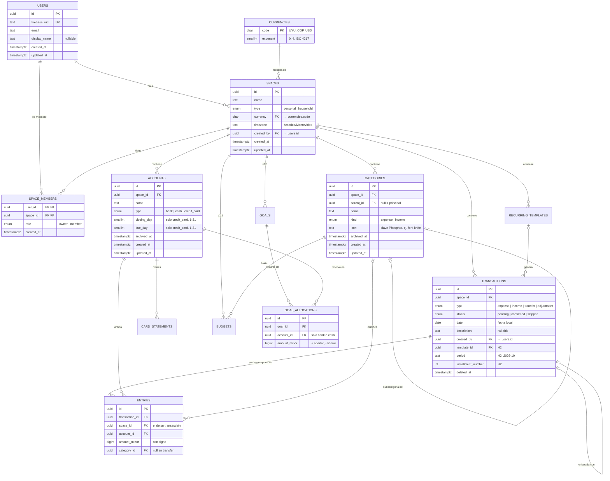

Personal Finance App · borrador v2
 
# Modelo de datos
 
Todas las tablas y cómo se relacionan. Nombres de tablas, columnas y valores en inglés (snake_case, tablas en plural); la interfaz sigue en español. La idea central: todo pertenece a un espacio, y el dinero se mueve con transacciones que se descomponen en asientos (`entries`).
 
## Diagrama
 

 
`||--o{` uno a muchos `||--|{` uno a uno o más `|o--o{` opcional El diagrama muestra solo las columnas clave; el detalle está abajo. En el diagrama, `enum` es conceptual: en la BD los valores de ese tipo son `text` con un CHECK con nombre (no un ENUM nativo de PostgreSQL).
 
## Reglas que el modelo garantiza
 
**El saldo se calcula, no se guarda**Suma de los `entries` de una cuenta cuya transacción está `confirmed` y sin `deleted_at`.
 
**Un transfer suma cero**Sus entries no llevan categoría. Banco −3.000, Tarjeta +3.000.
 
**Expense e income siempre clasificados**Cada entry lleva categoría. Permite dividir una compra a futuro.
 
**Adjustment no es ingreso ni gasto**Saldo inicial y cuadre con el banco. No aparece en los reportes.
 
**Un pendiente por plantilla y periodo**Restricción única (`template_id`, `period`). Así el cron es idempotente.
 
**Dinero en unidades menores enteras**`bigint`, nunca `float`. Se guarda ×10^exponente de su moneda (ISO 4217): $15,50 en USD o UYU = 1550; 1.500 en una moneda de exponente 0 (CLP, PYG) = 1500.
 
**Solo se aparta dinero que existe**Las metas reservan en cuentas `bank` o `cash`, nunca en una tarjeta.
 
**Los días de cierre y vencimiento son solo de las tarjetas**CHECK `ck_accounts_card_days`: una cuenta `credit_card` tiene `closing_day` y `due_day` (1 a 31), y una `bank` o `cash` no tiene ninguno. Lo validan también la API (422) y la BD.
 
**Un espacio personal por creador**Índice único parcial `uq_spaces_created_by_personal` sobre `spaces(created_by)` donde `type = 'personal'`. En v1 equivale a un espacio personal por usuario; unirse a un hogar en v2 (`space_members`) no la afecta, porque la regla mira quién creó el espacio, no la membresía.
 
**Un asiento no cruza espacios**`entries` repite `space_id` y sus tres FK son compuestas: `(transaction_id, space_id)`, `(account_id, space_id)` y `(category_id, space_id)` apuntan a `(id, space_id)`, que es único en `transactions`, `accounts` y `categories`. La BD rechaza un entry cuya transacción, cuenta o categoría estén en otro espacio, aunque el service lo olvide. Las tablas futuras que referencien filas del espacio siguen el mismo patrón.
 
**Categorías en dos niveles, del mismo tipo y con nombre único**Una subcategoría cuelga de una principal de su mismo espacio y su mismo `kind`, y no hay tercer nivel: lo impone una FK compuesta `(parent_id, space_id, kind, has_parent)` → `(id, space_id, kind, is_main)` con dos columnas generadas (`is_main`, `has_parent`). El nombre es único entre hermanas, sin distinguir mayúsculas y contando las archivadas (`uq_categories_main_name` por espacio y tipo, `uq_categories_sub_name` por principal). Por eso la siembra de las predefinidas es idempotente.
 
## Tablas
 
### users
 
v1
 
La persona que inicia sesión. Plural porque `user` es palabra reservada en PostgreSQL.
 
| idPK | uuid |
| --- | --- |
| firebase_uid | `NOT NULL`, único (`uq_users_firebase_uid`); enlaza con Firebase Auth |
| email | `NOT NULL`; sin restricción de unicidad (el login es por `firebase_uid`) |
| display_name | opcional (`NULL`); la interfaz usa la parte local del email al mostrarlo, no se guarda un valor derivado |
| created_at, updated_at | `timestamptz` (UTC); `updated_at` lo actualiza el ORM, sin trigger |
 
### spaces
 
v1
 
Dueño de todos los datos. Cada usuario recibe "Mi espacio" al registrarse.
 
| idPK | uuid |
| --- | --- |
| name | "Mi espacio", "Hogar Rodríguez" |
| type | personal · household (texto + CHECK `ck_spaces_type`) |
| currency | FK a `currencies.code` (UYU, COP, USD…); define la unidad menor de todos los montos del espacio |
| timezone | "America/Montevideo"; el cron la usa para saber qué día es |
| created_by | FK a `users.id` (`ON DELETE RESTRICT`); con `type = personal` es único (ver la regla "Un espacio personal por creador") |
| created_at, updated_at | `timestamptz` (UTC) |
 
### currencies

v1

Monedas soportadas y su exponente ISO 4217 (la unidad menor es 10^−exponente). Sumar una moneda es agregar una fila.

| codePK | char(3), tres letras mayúsculas: UYU, COP, USD |
| --- | --- |
| exponent | 0 a 4: 2 para UYU, COP, USD, ARS, BRL, EUR; 0 para CLP, PYG |

### space_members
 
v1
 
Quién tiene acceso a qué espacio. En v1, cada espacio tiene un solo miembro.
 
| user_idFK | `ON DELETE CASCADE`; con `space_id` forma la PK compuesta |
| --- | --- |
| space_idFK | `ON DELETE CASCADE`; índice `ix_space_members_space_id` |
| role | owner · member (v2); texto + CHECK `ck_space_members_role` |
| created_at | `timestamptz` (UTC) |
 
### accounts
 
v1
 
Banco, efectivo o tarjeta. La tarjeta suma a Deuda; las demás, a Disponible.
 
| idPK | uuid |
| --- | --- |
| space_idFK | `NOT NULL`, `ON DELETE RESTRICT` (el dinero no desaparece por una cascada desde su espacio); índice `ix_accounts_space_id` |
| name | "Itaú", "Visa"; `text` sin espacios en los extremos (lo recorta la API), no vacío (`ck_accounts_name_not_blank`) y de hasta 80 caracteres (`ck_accounts_name_length`). No es único: puede haber dos "Itaú" |
| type | bank · cash · credit_card (texto + CHECK `ck_accounts_type`); no se cambia después de crear la cuenta (decidido en KAN-63: el PATCH no lo acepta) |
| closing_day | `smallint`, solo credit_card, obligatorio ahí; 1 a 31 (`ck_accounts_closing_day_range`, y `ck_accounts_card_days` para "solo y obligatorio en tarjeta") |
| due_day | `smallint`, igual que `closing_day` (`ck_accounts_due_day_range`) |
| archived_at | `timestamptz`; null = activa. Archivar con saldo 0 y sin apartados lo aplica el service de archivar (BE-16); la tabla solo guarda la fecha |
| created_at, updated_at | `timestamptz` (UTC); `updated_at` lo actualiza el ORM, sin trigger |

`UNIQUE (id, space_id)` (`uq_accounts_id_space_id`) es el destino de la FK compuesta de `entries`.

El saldo no es una columna: se calcula con los `entries` (ver "Reglas que el modelo garantiza"). La API lo devuelve en cada cuenta como `balance_minor`, con signo: en una tarjeta es negativo cuando se debe. La lista de la API oculta las archivadas salvo con `?include_archived=true`.
 
### card_statements
 
v1
 
Fechas reales de cada cierre. Se calculan con los días de la cuenta y el usuario puede corregirlas si el banco las mueve.
 
| idPK | uuid |
| --- | --- |
| account_idFK |  |
| period | "2026-10" |
| closing_date |  |
| due_date |  |
 
### categories
 
v1
 
Dos niveles: principal y subcategoría. Se crean predefinidas (34, en español, cada una con su ícono) y el usuario las edita. Las recibe todo espacio personal al crearse (primer login) y la migración `0004` se las dio a los que ya existían.
 
| idPK | uuid |
| --- | --- |
| space_idFK | `NOT NULL`, `ON DELETE RESTRICT`; índice `ix_categories_space_id` |
| parent_idFK | null = categoría principal. FK compuesta `(parent_id, space_id, kind, has_parent)` → `(id, space_id, kind, is_main)`, `ON DELETE RESTRICT`: el padre es del mismo espacio, del mismo `kind` y principal (sin tercer nivel). No se cambia después de crear la categoría |
| name | "Comida"; `text` sin espacios en los extremos (lo recorta la API), no vacío (`ck_categories_name_not_blank`) y de hasta 80 caracteres (`ck_categories_name_length`). Único entre hermanas, sin distinguir mayúsculas y contando las archivadas: `uq_categories_main_name` `(space_id, kind, lower(name))` donde `parent_id IS NULL`, y `uq_categories_sub_name` `(parent_id, lower(name))` donde `parent_id IS NOT NULL` |
| kind | expense · income (texto + CHECK `ck_categories_kind`); una subcategoría tiene el de su principal. No se cambia después de crear la categoría |
| icon | `NOT NULL`; clave de un ícono de Phosphor en kebab-case (`fork-knife`; en React, `ForkKnife`). La BD solo comprueba la forma (`ck_categories_icon_format`: minúsculas, dígitos y guiones, hasta 40 caracteres); la lista fija de 66 íconos vive en la API (`app/modules/categories/icons.py`, un `Literal`), así que agregar uno no pide migración. La lista solo crece: una clave nunca se quita ni se renombra. Las predefinidas traen el suyo y al crear una se elige (decidido el 17/10/2026) |
| is_main, has_parent | `boolean` generadas (`parent_id IS NULL` y `parent_id IS NOT NULL`), nunca se escriben ni salen en la API: solo existen para que la FK compuesta pueda exigir que el padre sea principal |
| archived_at | `timestamptz`; null = activa. Archivar una principal archiva también sus subcategorías activas (mismo `archived_at`); desarchivarla restaura las que se archivaron junto con ella. Una archivada no se ofrece para movimientos nuevos, pero los movimientos viejos la conservan |
| created_at, updated_at | `timestamptz` (UTC); `updated_at` lo actualiza el ORM, sin trigger. La lista de la API sale en orden de creación (`created_at`, `id`) |
 
No hay borrado: solo se archiva. La lista de la API oculta las archivadas salvo con `?include_archived=true`, y es plana (cada subcategoría trae su `parent_id`). Además de la clave de `parent_id`, `UNIQUE (id, space_id)` (`uq_categories_id_space_id`) es el destino de la FK compuesta de `entries`. Un movimiento puede ir a una principal aunque tenga subcategorías (decidido en KAN-66).
 
### recurring_templates
 
v1
 
Suscripciones, servicios y cuotas. El cron la lee cada madrugada y genera pendientes.
 
| idPK | uuid |
| --- | --- |
| space_idFK |  |
| description | "Netflix", "TV Samsung" |
| type | expense · income |
| estimated_amount_minor |  |
| account_idFK |  |
| category_idFK |  |
| day_of_month | frecuencia mensual en v1 |
| start_date |  |
| total_installments | null = indefinida |
| is_active | false al cancelar o terminar cuotas |
 
### transactions
 
v1
 
El "qué pasó". Una línea en la lista de movimientos.
 
| idPK | uuid |
| --- | --- |
| space_idFK | `NOT NULL`, `ON DELETE RESTRICT` |
| type | expense · income · transfer · adjustment (texto + CHECK `ck_transactions_type`) |
| status | pending · confirmed · skipped (texto + CHECK `ck_transactions_status`, sin default). Un movimiento creado a mano nace `confirmed`; pendientes y saltados vienen de las plantillas (H2) |
| date | `date` NOT NULL: el día local del usuario según `spaces.timezone`, no un momento. La API solo acepta `YYYY-MM-DD` |
| description | `text` opcional (NULL); si viene, sin espacios en los extremos, no vacía (`ck_transactions_description_not_blank`) y de hasta 200 caracteres (`ck_transactions_description_length`). Los ajustes del sistema la dejan en NULL y la UI los rotula por tipo |
| template_idFK | **H2, todavía no existe.** null si es manual |
| period | **H2, todavía no existe.** Único junto con template_id |
| installment_number | **H2, todavía no existe.** "cuota 3 de 6" |
| linked_transaction_idFK | **v2, todavía no existe.** Aporte al hogar |
| created_byFK | `NOT NULL`, `ON DELETE RESTRICT`; usuario, útil en hogares |
| created_at, updated_at | `timestamptz` (UTC). Al editar, el backend rehace los entries |
| deleted_at | `timestamptz`; borrado suave, excluida de saldos y reportes |

Índices y claves: `UNIQUE (id, space_id)` (`uq_transactions_id_space_id`), destino de la FK compuesta de `entries`, e índice parcial `ix_transactions_space_id_date_id_active` sobre `(space_id, date DESC, id DESC) WHERE deleted_at IS NULL`, para la lista con cursor. Las columnas marcadas H2 o v2 se agregan con los módulos que las usan (decidido en KAN-66): un `ADD COLUMN` nullable en PostgreSQL no reescribe la tabla.
 
### entries
 
v1
 
Los asientos: cómo afecta cada cuenta. Una transacción tiene uno o más.
 
| idPK | uuid |
| --- | --- |
| transaction_idFK | FK compuesta `(transaction_id, space_id)` → `transactions`, `ON DELETE CASCADE` (la app nunca borra en duro); índice `ix_entries_transaction_id` |
| space_id | `NOT NULL`; el de su transacción, repetido a propósito para las FK compuestas (ver "Un asiento no cruza espacios") |
| account_idFK | FK compuesta `(account_id, space_id)` → `accounts`, `ON DELETE RESTRICT`; índice `ix_entries_account_id` |
| amount_minor | `bigint` con signo, distinto de 0 (`ck_entries_amount_not_zero`) y con valor absoluto ≤ 2^53 − 1 (`ck_entries_amount_range`, el entero seguro de JavaScript) |
| category_idFK | obligatoria en expense/income; null en transfer y adjustment. FK compuesta `(category_id, space_id)` → `categories`, `ON DELETE RESTRICT`; si es NULL la FK no se evalúa. Índice `ix_entries_category_id` |

Sin `created_at`: los entries se derivan de la transacción y se rehacen al editarla. No hay `UNIQUE (transaction_id, account_id)`, porque dividir una compra en varias categorías de la misma cuenta lo rompería. Qué tipo lleva categoría y que una transferencia sume cero no lo controla la BD (el entry no conoce su tipo): lo garantiza `build_entries`, con tests.
 
### budgets
 
v1.1
 
Límite mensual por categoría principal.
 
| idPK | uuid |
| --- | --- |
| space_idFK |  |
| category_idFK |  |
| monthly_limit_minor |  |
 
### goals
 
v1.1
 
"Viaje a Brasil", "PlayStation". Apartado virtual: el dinero sigue en sus cuentas.
 
| idPK | uuid |
| --- | --- |
| space_idFK |  |
| name |  |
| target_amount_minor |  |
| target_date | opcional |
| archived_at | al cumplirla o abandonarla |
 
### goal_allocations
 
v1.1
 
Cada vez que el usuario aparta o libera dinero, y en qué cuenta. No toca entries ni saldos.
 
| idPK | uuid |
| --- | --- |
| goal_idFK |  |
| account_idFK | solo bank o cash |
| amount_minor | + apartar · − liberar |
| date |  |
 
## Notas
 
- **Inglés en el código, español en la interfaz.** Los valores como `pending` o `expense` nunca se muestran tal cual: la UI los traduce. Los nombres que escribe el usuario ("Comida", "Itaú") se guardan como él los escribió.
- **La moneda vive en el espacio**: un hogar necesita su propia moneda. Cada transacción la hereda de su espacio.
- **Disponible, Deuda tarjetas y Neto** (`GET /spaces/{id}/balance-summary`, KAN-66): Disponible = suma de los saldos de las cuentas `bank` y `cash`; Deuda tarjetas = el opuesto de la suma de los saldos de las `credit_card` (positivo = se debe; sin recortar a 0, así que una tarjeta pagada de más da deuda negativa); Neto = Disponible − Deuda = suma de todos los saldos. Incluye las cuentas archivadas y solo cuenta movimientos `confirmed` sin `deleted_at`.
- **Libre para gastar** = Disponible − suma de `goal_allocations` de metas activas. Por cuenta: saldo − lo apartado en esa cuenta.
- **Cuotas futuras comprometidas** = monto de las plantillas con cuotas restantes × cuotas que faltan. No se crean transacciones por adelantado.